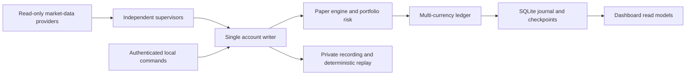

# CrossVenue

## Source-only publication snapshot

This repository contains application source, tests, example configuration and
third-party notices. It excludes account databases, credentials, local recordings,
logs and the original compressed test recording. The deterministic recording
builder uses fixed synthetic prices, timestamps and seed 7. Generate its temporary
fixture before running the offline suite:

```powershell
.venv-paper/Scripts/python.exe -c "from src.runtime.replay_fixtures import create_representative_fixture; create_representative_fixture('tests/fixtures/representative_recording', 'config/cross_asset_paper.example.json')"
```

The generated fixture is synthetic and cannot establish trading performance,
provider acceptance or a 24-hour stability result. No real provider is contacted
by that builder. Live trading requires separate explicit configuration.


Advisory venue lead/lag research is available under **System, Lead/lag research** and through `python -m src.runtime.paper_cli causal`.
See `docs/CAUSAL_ANALYSIS.md` for processing-time alignment, persistence, and limitations.

Cross-asset paper trading, deterministic replay and market-making research.
The desktop workbench covers crypto, US equities, G10 spot FX and CME futures.
Market-data connections are read-only. Orders, fills, balances and P&L are
simulated locally.

The project includes an event-driven limit-order-book simulator, a multi-currency
paper account, portfolio risk checks, sourced lifecycle adjustments and an
offline browser dashboard. It is a local single-user research application.

## Install and run

The supported desktop environment is Windows x64 with the dedicated Python
3.11 runtime. An existing Python installation with pip and internet access is
needed to download the hash-locked dependencies.

```powershell
.\scripts\windows\install.bat
.\.venv-paper\Scripts\python.exe examples/basic_simulation.py
```

Run a deterministic four-market synthetic replay without credentials:

```powershell
.\.venv-paper\Scripts\python.exe -m src.runtime.paper_cli replay tests/fixtures/representative_recording
```

For a new cross-asset account, create a private configuration without replacing
an existing one:

```powershell
if (-not (Test-Path config/cross_asset_paper.json)) {
    Copy-Item config/cross_asset_paper.example.json config/cross_asset_paper.json
}
.\.venv-paper\Scripts\python.exe -m src.runtime.paper_cli doctor --config config/cross_asset_paper.json
.\scripts\windows\start_paper.bat
```

The dashboard uses loopback port 8877 and opens in Trading. Search and filter
the watchlist for crypto, stocks, FX or futures. Portfolio shows account totals,
Activity shows persisted history, and System explains provider access and
accounting blocks. Strategy variables are collapsible drafts until Apply.
Start controls portfolio quoting; selecting an instrument never starts it.
The durable account waits for an explicit Start. Stop all cancels working paper
quotes. Unavailable feeds stay visible without fabricated prices or fills.

The separate `scripts/windows/start_crypto.bat` runner uses public Binance
BTC/USDT data with a legacy in-memory spot account. It retains its one-time
automatic readiness start. Its balances are separate from the durable account,
and restarting it loses that in-memory session.

## Market-data access and private configuration

| Market | Read-only provider | Access |
|---|---|---|
| Crypto | Binance public streams | No credential required |
| US equities | Databento | Suitable market-data access and entitlements |
| CME futures | Databento | Suitable market-data access and entitlements |
| Spot FX | OANDA v20 pricing | Account access for the selected environment |

Provider credentials are supplied locally. Databento reads `DATABENTO_API_KEY`;
OANDA reads `OANDA_ACCOUNT_ID` and `OANDA_ACCESS_TOKEN`. On Windows, run
`scripts/windows/setup_market_data.bat` to enter them through protected prompts.
The helper encrypts them outside the repository and the paper starter loads
them into its child process. Environment variables can also be configured
locally. No account, subscription or entitlement is included.

Public configuration files contain illustrative instruments, fees, paper funds,
margin and conversion assumptions. Review them before interpreting results.
The ES contract is explicitly selected and is not automatically a front-month
selection. Do not lower margin or add unexplained funds to force trading.
The account-action example documents the input shapes for sourced splits,
dividends, borrowing, financing, settlements and valuation marks.

Private configuration, credential stores, generated authenticated dashboards,
databases, recordings and output files are ignored by Git. Never commit them.
An authenticated dashboard file contains a per-session token and must stay
local even after the backend has stopped.

## How it works



Each instrument has its own feed, session and accounting readiness. Provider
failures invalidate only their instruments. Queues are bounded, and overflow
requires resynchronisation instead of silently discarding execution evidence.

Paper fills require eligible post-order observations and configured latency.
Trade-print liquidity is shared once. FX fills are conservative quote-crossing
estimates with shared per-side displayed-liquidity caps. They are labelled as
estimates and never presented as observed exchange executions or public trades.
Zero fills can be a correct outcome.

The ledger tracks native cash and instrument positions. Risk includes pending
orders, fees, multipliers, currency conversion, margin and borrow permissions.
Strict reducing closes cannot cross zero. Equity shorts need complete borrow
inputs; derivatives need configured margin. Futures rolls validate both legs
and persist atomically. Lifecycle actions require sources, effective times and
stable IDs. Missing mandatory inputs block additional affected risk.

The journal commits before financial acknowledgements. Restart retains account
history, drops working orders and waits for fresh feeds and explicit Start.
Use `python -m src.runtime.account_admin --help` for preview, backup, migration
and restore commands. Back up before migration; restore into a new destination
and verify it before cutover. Never reset balances to resolve a configuration
mismatch.

Recordings retain processing order, clocks, configuration, seeds and outcomes.
Schema-2 recordings include checksummed prior-action signatures for restored
accounts. Keep the entire recording directory together. Replay never opens the
original account database. Older recordings cannot reconstruct omitted history.
The offline self-impact model changes a synthetic reference price independently
of provider prices and resting-order queue position.

## Tests and research

```powershell
.\scripts\windows\install.bat -BrowserTests
.\.venv-paper\Scripts\python.exe -m pytest -q -m "not browser and not live and not performance" --deselect=tests/test_replay_soak.py::test_standalone_soak_cli_explicitly_labels_historical_re_evaluation
.\.venv-paper\Scripts\python.exe tools/release_audit.py --root .
```

Tests use isolated accounts, synthetic fixtures and a local browser backend.
They do not require provider credentials or submit exchange orders. The portable
engine suite is also configured for Linux CI; desktop installation is Windows.

For research commands, run `python -m src.runtime.paper_cli --help`. Record,
replay, evaluate and finite benchmark commands keep their outputs local.
Evaluation compares fixed and adaptive candidates on chronological 60/20/20
periods with complete costs and conservative execution scenarios. Live adaptive
quoting is disabled by default. Missing calibration data stays unvalidated.

Live-provider acceptance, a 24-hour soak and latency qualification remain
pending. A 100-instrument UI fixture does not certify backend throughput.
Repository-wide lint, strict typing and complexity also have existing debt.
The legacy AS-inspired strategy needs dimensional calibration before theoretical
interpretation. Profitability and real execution quality are not guaranteed.

## Layout and licence

`src/` contains the engine, data adapters and accounting. `assets/` contains
offline dashboard assets. `config/` contains public examples. `scripts/windows/`
contains installers and starters. `tests/` and `examples/` contain reproducible
fixtures and simulations. `tools/` contains the source-export privacy checker.

Original project code uses the [PolyForm Noncommercial licence](LICENSE). Third-party licence notices are
retained in [NOTICE.md](NOTICE.md) and the bundled Chart.js asset notice.

## Licence

Original project code is source-available under the [PolyForm Noncommercial
License 1.0.0](LICENSE). Commercial use requires separate permission. Third-party
code, assets and dependencies retain their own terms; see [LICENSING.md](LICENSING.md).
Earlier grants for previously released copies remain valid.

The source-only offline selection is `python -m pytest -q -m "not browser and not live and not performance" --deselect=tests/test_replay_soak.py::test_standalone_soak_cli_explicitly_labels_historical_re_evaluation`. The retained, deselected legacy-recording regression requires the omitted historical recording. Generated current-semantic inputs cannot establish that historical result.
